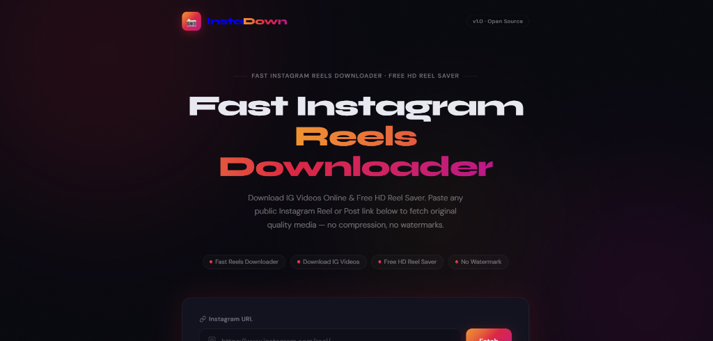
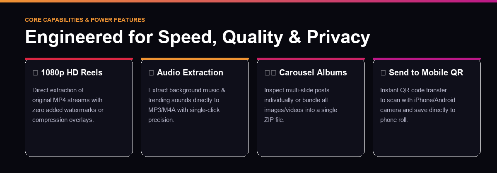
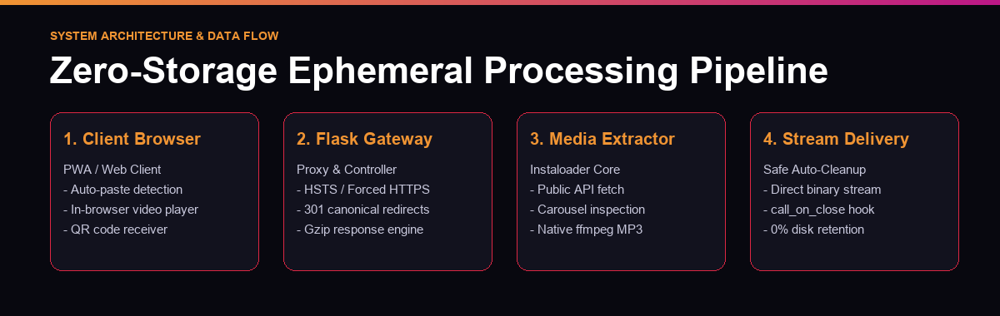

<div align="center">

# ⚡ InstaDown
### Fast Instagram Reels Downloader, Audio Extractor & HD Media Saver

*A modern, production-ready web application engineered with Python 3, Flask, Instaloader, and a sleek dark glassmorphism interface.*

<br/>

[](https://instagram-story-downloader.onrender.com/)
[](https://python.org)
[](https://flask.palletsprojects.com/)
[](https://github.com/KisholoyDD21/Instagram-story-Downloader/actions)
[](https://instagram-story-downloader.onrender.com/)
[](LICENSE)

<br/>

<p align="center">
  <a href="https://instagram-story-downloader.onrender.com/"><strong>🌐 Launch Live Web App</strong></a> •
  <a href="#-key-features"><strong>✨ Key Features</strong></a> •
  <a href="#-system-architecture"><strong>🏗️ Architecture</strong></a> •
  <a href="#-quick-start"><strong>🚀 Quick Start</strong></a> •
  <a href="#-api-documentation"><strong>📡 API Reference</strong></a>
</p>

---

<br/>



</div>

<br/>

## 📖 Table of Contents

- [Overview](#-overview)
- [Key Features](#-key-features)
- [System Architecture](#-system-architecture)
- [User Experience & Mobile Design](#-user-experience--mobile-design)
- [Tech Stack](#-tech-stack)
- [Project Structure](#-project-structure)
- [Quick Start](#-quick-start)
  - [Prerequisites](#prerequisites)
  - [Local Installation](#local-installation)
  - [Docker Deployment](#docker-deployment)
- [Environment Variables](#-environment-variables)
- [API Documentation](#-api-documentation)
- [Security, Privacy & GDPR](#-security-privacy--gdpr)
- [Automated Testing](#-automated-testing)
- [Contributing](#-contributing)
- [Disclaimers & Rights](#-disclaimers--rights)
- [License](#-license)

---

## 🌟 Overview

**InstaDown** is a full-featured, privacy-conscious Instagram media retrieval platform. Built specifically to deliver an ultra-fast, watermark-free experience, it empowers creators, educators, and social media managers to archive their public content, extract trending background music, inspect individual carousel slides, and seamlessly send downloaded media directly to their mobile devices.

Designed with a **dark glassmorphism aesthetic**, **server-side rendering (SSR)**, and comprehensive **Progressive Web App (PWA)** capabilities, InstaDown provides a native app-like experience across desktop browsers, iPads, iPhones, and Android smartphones.

---

## ✨ Key Features

<div align="center">



</div>

### 🎥 Media Processing & Downloading
- **Reels & Video Saver**: Download high-definition `.mp4` video clips from public Instagram Reels, traditional video posts, and IGTV without added watermarks or compression loss.
- **In-Browser Video Preview**: Playback extracted videos directly within the web page before initiating the download, complete with native controls.
- **🎵 MP3 Audio Extractor**: Convert background audio and trending sounds from Reels into crystal-clear 192 kbps `.mp3` files in real time.
- **🖼️ Carousel Album Inspector**: View each individual slide in multi-photo or multi-video albums (`GraphSidecar`). Download single slides or pack the complete album into a compressed `.zip` archive.

### 📱 Modern User Experience
- **⚡ 1-Click Clipboard Integration**: A dedicated "Paste from Clipboard" action automatically accesses clipboard URLs, clears errors, and queries the backend instantly.
- **📲 Desktop-to-Mobile Transfer (QR Code)**: Automatically creates a high-contrast QR code for any media link, enabling instant mobile camera scanning and saving directly into the user's phone camera roll.
- **🕒 Private History Drawer**: Stores previously queried links in client-side `localStorage`. Completely isolated with zero server footprint or tracking.
- **📲 Progressive Web App (PWA)**: Full offline service worker caching (`sw.js`) and web app manifest (`manifest.json`) supporting "Add to Home Screen" on iOS and Android.

### 🛡️ Production & Enterprise Hardening
- **Server-Side Rendering (SSR)**: Dynamic Jinja2 server templates deliver instant initial content paints, eliminating empty single-page application loading flickers.
- **Zero Secrets on Front End**: No API tokens, session secrets, or private keys are bundled into client-side JavaScript.
- **Forced HTTPS & Canonical 301 Normalization**: Enforces secure TLS, strips superfluous trailing slashes with permanent 301 redirects, and sets strict HSTS headers.
- **🍪 GDPR / CCPA Cookie Consent**: Polished cookie notification system storing user preferences (`Accept All` vs. `Essential Only`).
- **Comprehensive SEO Suite**: Fully indexed with `sitemap.xml`, `robots.txt`, dynamic OpenGraph 1200×630 cards, Twitter summaries, and Schema.org `WebApplication` structured JSON-LD.

---

## 🏗️ System Architecture

InstaDown is organized as a decoupled, layered micro-architecture balancing server-side reliability with responsive client interactivity:

<div align="center">



</div>

### Architectural Layers

| Layer | Technology | Responsibility |
| :--- | :--- | :--- |
| **Presentation Tier** | Semantic HTML5, CSS3 Glassmorphism, Vanilla JS | Responsive rendering, QR generation, private local history, in-browser video playback |
| **Application Tier** | Python 3.11+, Flask 3.0, Gunicorn | SSR page generation, REST endpoints (`/api/info`, `/api/download`, `/api/health`), canonical routing |
| **Extraction Tier** | Instaloader, Requests | Resolving public Instagram shortcodes, metadata extraction, media CDN stream proxying |
| **Audio Processing** | FFmpeg Native CLI / Python Subprocess | On-the-fly demuxing and encoding of video streams into standard MP3 audio |
| **Storage & Caching** | LocalStorage, Service Worker (Cache API) | Client-side recent history, offline asset caching; zero permanent server media persistence |

---

## 📱 User Experience & Mobile Design

InstaDown has been meticulously styled to look and feel like a modern native application on all screen sizes:

- **Mobile Viewport Optimization**: Responsive CSS Grid and Flexbox layouts prevent button overlap, text collisions, or accidental viewport horizontal scrolling.
- **Cross-Platform Input Uniformity**: Enforced `-webkit-appearance: none` and custom touch-target resets eliminate default gray/white operating system button overlays on iOS Safari and Android Chrome.
- **Fluid Dark Glassmorphism**: High-contrast typography (`Inter` / system-ui), multi-stop linear gradients, soft ambient drop shadows, and subtle translucent border highlights (`rgba(255, 255, 255, 0.08)`).
- **Graceful Error States**: Intuitive feedback alerts for private accounts, invalid URLs, rate limits, or network interruptions.

---

## 💻 Tech Stack

### Backend & Core
- **Language**: Python 3.10+ / 3.11 / 3.12 / 3.14
- **Web Framework**: Flask 3.0 (WSGI Application)
- **Production Server**: Gunicorn
- **Extraction Engine**: Instaloader
- **Media Transcoding**: FFmpeg

### Frontend & Client
- **Templating**: Jinja2 SSR
- **Styling**: Vanilla CSS3 (Custom Glassmorphism Design System, CSS Variables)
- **Scripting**: Vanilla ECMAScript (Zero heavyweight frontend framework dependencies)
- **PWA**: Service Worker API, Cache API, Web App Manifest
- **QR Engine**: QRious Canvas Generator

### DevOps & Quality Assurance
- **Testing**: Pytest (17 automated unit and integration tests)
- **Containerization**: Docker (Debian slim with native ffmpeg)
- **CI/CD**: GitHub Actions (Lint, Security Scan, Pytest Matrix)
- **Hosting**: Render Cloud Platform

---

## 📂 Project Structure

```text
Instagram-story-Downloader/
├── .github/
│   ├── ISSUE_TEMPLATE/
│   │   ├── bug_report.md          # Standardized bug reporting form
│   │   └── feature_request.md     # Feature submission proposal
│   └── workflows/
│       └── ci.yml                 # Automated GitHub Actions test workflow
├── doc/
│   ├── banner.png                 # Main project hero banner
│   ├── features_banner.png        # Features showcase diagram
│   └── architecture_banner.png    # Data pipeline & system architecture visual
├── static/
│   ├── css/
│   │   └── styles.css             # Glassmorphic stylesheet & responsive rules
│   ├── js/
│   │   └── main.js                # Frontend controller: fetch, audio, QR, history
│   ├── images/
│   │   ├── apple-touch-icon.png   # iOS home screen touch icon (180x180)
│   │   ├── favicon.ico            # Multi-resolution favicon (16/32/48)
│   │   ├── favicon.svg            # Vector camera glyph favicon
│   │   └── social-preview.png     # OpenGraph 1200x630 social preview card
│   ├── manifest.json              # Progressive Web App manifest
│   └── sw.js                      # Service Worker caching logic
├── templates/
│   ├── 404.html                   # Custom branded 404 error page
│   ├── base.html                  # Master layout (SEO meta, nav, modals, footer)
│   ├── index.html                 # Main interface: tabs, input card, previews
│   ├── privacy.html               # GDPR & CCPA compliant privacy statement
│   └── terms.html                 # Comprehensive terms and conditions
├── tests/
│   └── test_app.py                # Pytest validation suite (17 test cases)
├── .env.example                   # Sample environment configuration file
├── .gitignore                     # Git ignore specifications
├── app.py                         # Flask application & API routes
├── Dockerfile                     # Docker container recipe with FFmpeg
├── LICENSE                        # MIT Open Source License
├── Procfile                       # Process file for Render/Heroku deployments
├── README.md                      # Project documentation
└── requirements.txt               # Pinned Python package dependencies
```

---

## 🚀 Quick Start

### Prerequisites
- **Python**: Version 3.10 or higher
- **FFmpeg**: Required for MP3 audio extraction ([Download FFmpeg](https://ffmpeg.org/download.html))
- **Git**: Installed and available on your PATH

### Local Installation

#### 1. Clone the repository
```bash
git clone https://github.com/KisholoyDD21/Instagram-story-Downloader.git
cd Instagram-story-Downloader
```

#### 2. Create and activate a virtual environment
```bash
# On Windows
python -m venv .venv
.venv\Scripts\activate

# On macOS & Linux
python3 -m venv .venv
source .venv/bin/activate
```

#### 3. Install Python dependencies
```bash
pip install -r requirements.txt
```

#### 4. Configure environment settings
```bash
# Copy example configuration
cp .env.example .env
```
*(Optionally review `.env` and set custom ports or analytics identifiers)*

#### 5. Run the automated test suite
```bash
python -m pytest tests/ -v
```

#### 6. Start the local server
```bash
python app.py
```
Open **[http://127.0.0.1:5000](http://127.0.0.1:5000)** in your browser.

---

### 🐳 Docker Deployment

InstaDown comes preconfigured with a multi-stage Docker build including all necessary Python runtimes and the FFmpeg media encoder:

```bash
# Build the Docker image
docker build -t instadown:latest .

# Run the container exposing port 5000
docker run -d \
  -p 5000:5000 \
  -e PORT=5000 \
  --name instadown-container \
  instadown:latest
```

Verify your container is active:
```bash
curl http://localhost:5000/api/health
```

---

## ⚙️ Environment Variables

Configure application behavior using the following environment parameters:

| Variable | Type | Default | Description |
| :--- | :---: | :--- | :--- |
| `PORT` | `integer` | `5000` | Local or container port for the HTTP server |
| `FLASK_SECRET_KEY` | `string` | *(Auto-generated random hex)* | Cryptographic key used to secure session state |
| `BASE_URL` | `string` | `https://instagram-story-downloader.onrender.com` | Base canonical domain (used in sitemaps and OpenGraph tags) |
| `GA_MEASUREMENT_ID` | `string` | `""` | Google Analytics 4 Measurement ID (e.g., `G-XXXXXXXXXX`) |
| `GOOGLE_SITE_VERIFICATION` | `string` | `googled6b96ac3b100fcd2` | Meta tag code for Google Search Console domain ownership |

---

## 📡 API Documentation

InstaDown includes clean, predictable RESTful endpoints:

### 1. Health Status
Check service operational readiness and feature flags:
```http
GET /api/health
```
**Example Response (`200 OK`):**
```json
{
  "features": {
    "audio_extraction": true,
    "carousel_inspection": true,
    "pwa": true,
    "reels_download": true
  },
  "service": "InstaDown",
  "status": "healthy",
  "version": "1.3.0"
}
```

---

### 2. Extract Media Metadata
Retrieve post owner info, caption, like count, media type, and carousel nodes without downloading binary streams:
```http
POST /api/info
Content-Type: application/json

{
  "url": "https://www.instagram.com/reel/C-xyz123_4/"
}
```
**Example Response (`200 OK`):**
```json
{
  "caption": "Exploring hidden gems in Tokyo 🎌 #travel #japan",
  "is_video": true,
  "likes": 14200,
  "owner": "travel_diaries",
  "owner_pic": "https://...",
  "shortcode": "C-xyz123_4",
  "thumbnail": "https://...",
  "type": "video",
  "video_url": "https://...",
  "slides": []
}
```

---

### 3. Stream & Download Media
Fetch, convert, or archive media files on demand:
```http
POST /api/download
Content-Type: application/json

{
  "url": "https://www.instagram.com/reel/C-xyz123_4/",
  "type": "audio"
}
```

**Payload Options:**
- `"type": "default"`: Downloads primary video (`.mp4`) or primary photo (`.jpg`).
- `"type": "audio"`: Converts source audio stream to an `.mp3` download.
- `"type": "zip"`: Downloads all slides in a multi-image carousel bundled into a single `.zip`.
- `"slide": 1`: Selects an individual slide from a multi-photo carousel post.

---

## 🔒 Security, Privacy & GDPR

- **No Server-Side Tracking**: InstaDown does not store user download histories, submitted URLs, or media files permanently on server disks.
- **GDPR & CCPA Compliant**: Explicit cookie consent banner allows users to reject all non-essential cookies.
- **HSTS & Security Headers**: Includes `X-Content-Type-Options: nosniff`, `X-Frame-Options: SAMEORIGIN`, `Referrer-Policy: strict-origin-when-cross-origin`, and `Permissions-Policy`.
- **Zero Front-End Secret Exposure**: All backend APIs validate requests with defensive error checking and zero sensitive tokens transmitted to client scripts.

---

## 🧪 Automated Testing

InstaDown maintains an automated test suite covering routing, security headers, metadata parsing, PWA compliance, and error handlers:

```bash
# Run pytest with detailed verbose reporting
python -m pytest tests/ -v
```

**Test Coverage Summary:**
- ✅ `test_homepage`: SSR HTML response, status code, meta tags
- ✅ `test_privacy_page` & `test_terms_page`: Legal disclosures
- ✅ `test_robots_txt` & `test_sitemap_xml`: Crawlability and XML schema
- ✅ `test_favicon` & `test_pwa_manifest`: App manifest and icons
- ✅ `test_service_worker`: Offline worker serving and caching
- ✅ `test_security_headers`: HSTS, X-Frame-Options, X-Content-Type
- ✅ `test_custom_404`: Custom error handler page
- ✅ `test_301_redirects`: Trailing-slash normalization
- ✅ `test_api_health`: Operational health check endpoint
- ✅ `test_api_info_invalid_url` & `test_api_download_invalid_url`: Defensive validation

---

## 🤝 Contributing

Contributions are what make the open source community such an incredible place to learn, inspire, and create. Any contributions you make are **greatly appreciated**.

1. Fork the Project
2. Create your Feature Branch:
   ```bash
   git checkout -b feature/CoolNewFeature
   ```
3. Commit your changes with clear messages:
   ```bash
   git commit -m "feat: add support for IGTV chapter markers"
   ```
4. Push to your branch:
   ```bash
   git push origin feature/CoolNewFeature
   ```
5. Open a Pull Request

---

## ⚠️ Disclaimers & Rights

- **Intellectual Property**: InstaDown respects the rights of content creators. All images, videos, audio tracks, and branding downloaded through this application belong to their respective copyright holders. This utility is made available strictly for personal backup, research, and fair-use archiving purposes.
- **Independent Project**: InstaDown is an independent open-source project and is **not** endorsed by, associated with, or affiliated with Instagram, Meta Platforms, Inc., or any of their subsidiaries.

---

## 📄 License

Distributed under the **MIT License**. See [`LICENSE`](LICENSE) for full details.

<br/>

<div align="center">
  <sub>Engineered with care by <a href="https://github.com/KisholoyDD21">Kisholoy Paul</a>. Star this repo if you find it helpful! ⭐</sub>
</div>
